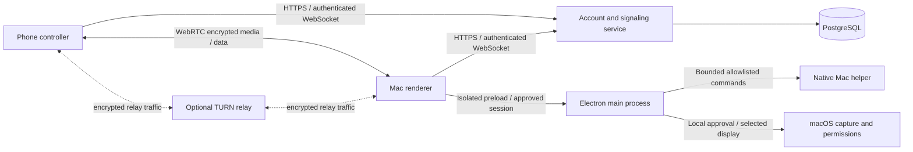

# Remote access threat model

Version 1, 2026-11-19. Assumptions require validation; this document does not claim complete threat coverage.

## Assets and trust boundaries

Protect passwords, email identities, bearer tokens, paired-device records, TURN secrets, screen content, app/window information, native input authority, signing keys and release artifacts.

The service is trusted for accounts, ownership, discovery and signaling. It must never execute remote input, shell commands or screen capture. WebRTC transport encryption does not by itself prove peer identity independently of signaling. A malicious service or stolen account therefore needs an explicit analysis and a device-bound trust design.

The Mac renderer is less trusted than Electron main/native helper. Only bundled app content may call IPC, each native command requires local approved-session authority, and received data must be validated at the final privilege boundary. macOS permissions are necessary but do not replace per-session consent.

## Threats and evidence to collect

| Threat / entry | Invariant and required tests |
| --- | --- |
| Credential stuffing, email pre-hijacking, recovery abuse | Verified account ownership; generic recovery responses; one-use expiring tokens; MFA/reauthentication policy; account and network limits. |
| Cross-account device enumeration or connection | A different account cannot list, rename, connect, approve or signal to the owner's devices. Repeat after revocation and deletion. |
| Forged, replayed or substituted session / SDP | Approval is bound to the intended device pair and fresh session; no control before approval; expired/revoked identities cannot continue; evaluate malicious signaling. |
| Untrusted IPC / malformed data channel command | Sender identity, runtime schema validation, bounds, allowlisted app launch, no arbitrary shell/URL/filesystem action. Test navigation, frames and stale session IDs. |
| Display change or permission revocation | Only the explicitly selected display is captured; invalid selection and lost permission fail closed; explain recovery without claiming readiness. |
| Backgrounding, network loss, frozen video, helper crash | Local stop remains available; peer cleanup releases held inputs and capture; controls are disabled without playing video; no stale connection indicator. Test real OS behavior. |
| Resource exhaustion | Bound pre-auth sockets, per-account requests, expensive password hashes, payloads, commands and native queues; measure proxy and concurrent-account behavior. |
| Installer, dependency or CI compromise | Pinned/verified inputs, least-privilege CI, review gates, SBOM/provenance, signed and notarized builds, authenticated updates, tested rollback. |
| Accidental data exposure | Never log passwords, bearer tokens, text commands or screen content; restrict operational logs, retain minimal events, restore and delete data predictably. |

## Privacy and abuse decisions

Maintain explicit local approval for every session in the first release. Unattended access is outside this milestone and requires a separate threat model. A connected Mac must expose an immediate End session action. Do not add screen recording, clipboard synchronization, arbitrary remote shell or file transfer without separate consent and review. TURN may observe network metadata; it must not be described as a screen-recording backend.

Resolve whether new-device enrollment requires MFA, what session inactivity/maximum durations apply, how peer device keys are enrolled/recovered, and what events operators retain. These decisions precede account/session implementation, rather than being inferred from a visual redesign.
